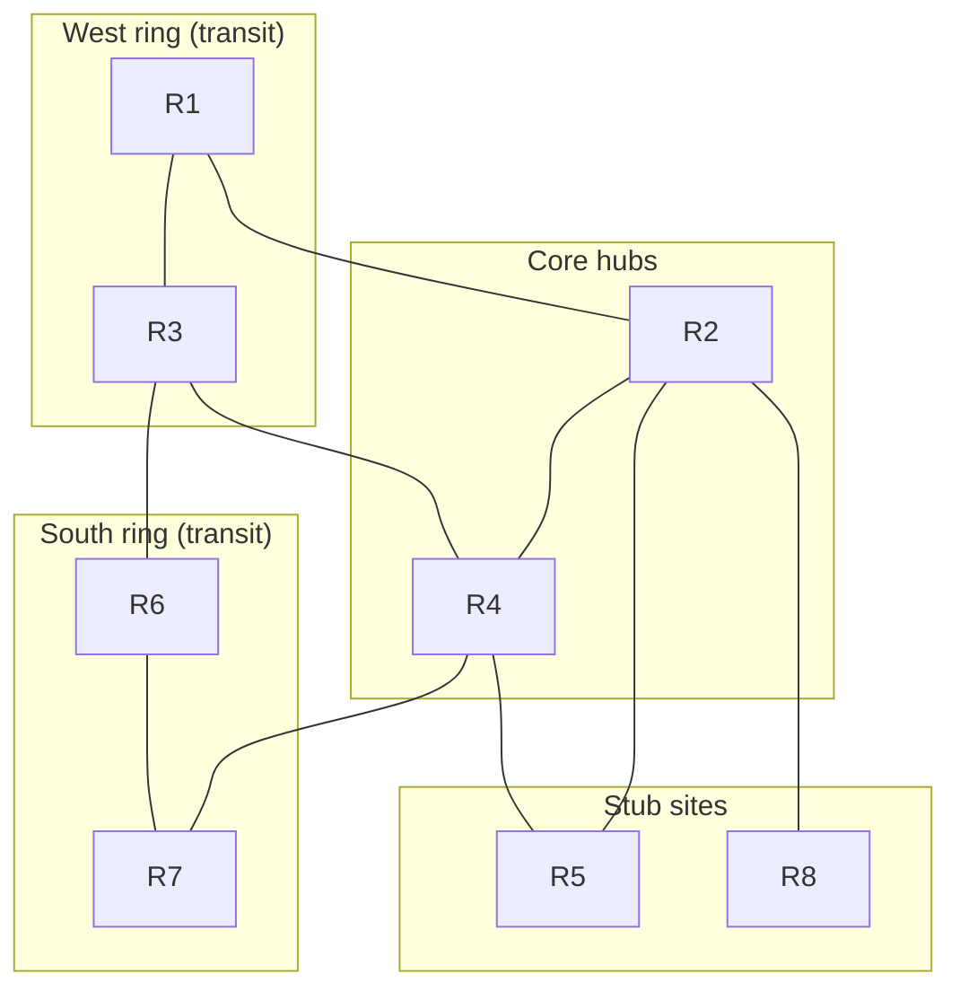

# EIGRP Named Mode Design Lab: Hierarchical IP Plan, Summarization, Stub Routing & Load Balancing


This repository contains the full architecture, Cisco IOS-XE configurations, protocol behavioral analysis, and verification tasks for an **8-router EIGRP Named Mode design** (AS 100, instance `ENT`) built inside a single **10.0.0.0/16** address block, with a mesh-and-ring topology, two core hubs, two transit rings and two stub sites.


---

## 📋 Overview & Design Objectives

* **Hierarchical Addressing (`10.0.0.0/16`):**
  * **Regional Blocks:** West, South and Edge regions each own a `/21`, and every router owns one `/23` inside it, so each router advertises exactly one summary.
  * **Compact Infrastructure:** `/30` point-to-point links in `10.0.1.0/24`, `/32` loopbacks in `10.0.0.0/24`.
  * **Predictable Router-IDs:** `Loopback0` (`10.0.0.<n>`) doubles as the EIGRP router-ID on every router.
* **EIGRP Named Mode:**
  * **Single instance:** `router eigrp ENT`, `address-family ipv4 unicast autonomous-system 100`, wide metrics.
  * **Passive-interface default:** `af-interface default` is passive; only the 20 link interfaces are enabled with `no passive-interface`.
  * **Authentication:** HMAC-SHA-256 under `af-interface default`.
* **Summarization:**
  * **Per-router `/23`:** each router summarizes its two simulated `/24` LANs on every active interface (Null0 discard route installed locally).
  * **Default routes to stubs:** the hubs R2 and R4 send only `0.0.0.0/0` toward R5 and R8.
* **Stub Routing:** `eigrp stub connected summary` on R5 (dual-homed) and R8 (single-homed leaf). Ring routers are deliberately **not** stubs.
* **Load Balancing:**
  * **ECLB:** `maximum-paths 4` everywhere; equal-cost paths appear naturally on the rings, and R5 receives the default route from both hubs.
  * **UCLB:** `variance 2` on R6 with a deliberate `delay 100` on `Gi0/1`, so the R7 path is a feasible but more expensive alternative.

---

## 📐 Network Topology




---

## 🧭 Address Space Allocation

| Block | Use |
| :--- | :--- |
| `10.0.0.0/24` | **Loopback0** `/32`s, `10.0.0.<n>` |
| `10.0.1.0/24` | **Point-to-point links**, one `/30` each |
| `10.0.2.0/23` | Infrastructure growth (reserved) |
| `10.0.16.0/21` | **West region**: R1 `10.0.16.0/23`, R3 `10.0.18.0/23` |
| `10.0.24.0/21` | **South region**: R6 `10.0.24.0/23`, R7 `10.0.26.0/23` |
| `10.0.32.0/21` | **Edge region**: R5 `10.0.32.0/23`, R8 `10.0.34.0/23` |
| `10.0.40.0/21` and up | Future regions |

## 🏷️ Addressing Matrix & EIGRP Interface Roles

<!-- BEGIN:node-matrix -->
| Node | Role | Interface | IP address / mask | Connected to | EIGRP |
| :--- | :--- | :--- | :--- | :--- | :--- |
| **R1** | Transit (west ring) | `Lo0`<br>`Lo10`<br>`Lo11`<br>`Gi0/0`<br>`Gi0/1` | `10.0.0.1/32`<br>`10.0.16.1/24`<br>`10.0.17.1/24`<br>`10.0.1.1/30`<br>`10.0.1.5/30` | Router-ID<br>Simulated LAN<br>Simulated LAN<br>R2 Gi0/0 (L1)<br>R3 Gi0/0 (L2) | Passive<br>Passive<br>Passive<br>Active<br>Active |
| **R2** | Core hub | `Lo0`<br>`Gi0/0`<br>`Gi0/1`<br>`Gi0/2`<br>`Gi0/3` | `10.0.0.2/32`<br>`10.0.1.2/30`<br>`10.0.1.9/30`<br>`10.0.1.13/30`<br>`10.0.1.17/30` | Router-ID<br>R1 Gi0/0 (L1)<br>R4 Gi0/0 (L3)<br>R5 Gi0/0 (L4)<br>R8 Gi0/0 (L5) | Passive<br>Active<br>Active<br>Active<br>Active |
| **R3** | Transit (west ring) | `Lo0`<br>`Lo10`<br>`Lo11`<br>`Gi0/0`<br>`Gi0/1`<br>`Gi0/2` | `10.0.0.3/32`<br>`10.0.18.1/24`<br>`10.0.19.1/24`<br>`10.0.1.6/30`<br>`10.0.1.37/30`<br>`10.0.1.21/30` | Router-ID<br>Simulated LAN<br>Simulated LAN<br>R1 Gi0/1 (L2)<br>R4 Gi0/1 (L10)<br>R6 Gi0/0 (L6) | Passive<br>Passive<br>Passive<br>Active<br>Active<br>Active |
| **R4** | Core hub | `Lo0`<br>`Gi0/0`<br>`Gi0/1`<br>`Gi0/2`<br>`Gi0/3` | `10.0.0.4/32`<br>`10.0.1.10/30`<br>`10.0.1.38/30`<br>`10.0.1.25/30`<br>`10.0.1.29/30` | Router-ID<br>R2 Gi0/1 (L3)<br>R3 Gi0/1 (L10)<br>R5 Gi0/1 (L7)<br>R7 Gi0/0 (L8) | Passive<br>Active<br>Active<br>Active<br>Active |
| **R5** | Stub site (dual-homed) | `Lo0`<br>`Lo10`<br>`Lo11`<br>`Gi0/0`<br>`Gi0/1` | `10.0.0.5/32`<br>`10.0.32.1/24`<br>`10.0.33.1/24`<br>`10.0.1.14/30`<br>`10.0.1.26/30` | Router-ID<br>Simulated LAN<br>Simulated LAN<br>R2 Gi0/2 (L4)<br>R4 Gi0/2 (L7) | Passive<br>Passive<br>Passive<br>Active<br>Active |
| **R6** | Transit (south ring), UCLB point | `Lo0`<br>`Lo10`<br>`Lo11`<br>`Gi0/0`<br>`Gi0/1` | `10.0.0.6/32`<br>`10.0.24.1/24`<br>`10.0.25.1/24`<br>`10.0.1.22/30`<br>`10.0.1.33/30` | Router-ID<br>Simulated LAN<br>Simulated LAN<br>R3 Gi0/2 (L6)<br>R7 Gi0/1 (L9) | Passive<br>Passive<br>Passive<br>Active<br>Active |
| **R7** | Transit (south ring) | `Lo0`<br>`Lo10`<br>`Lo11`<br>`Gi0/0`<br>`Gi0/1` | `10.0.0.7/32`<br>`10.0.26.1/24`<br>`10.0.27.1/24`<br>`10.0.1.30/30`<br>`10.0.1.34/30` | Router-ID<br>Simulated LAN<br>Simulated LAN<br>R4 Gi0/3 (L8)<br>R6 Gi0/1 (L9) | Passive<br>Passive<br>Passive<br>Active<br>Active |
| **R8** | Stub leaf (single-homed) | `Lo0`<br>`Lo10`<br>`Lo11`<br>`Gi0/0` | `10.0.0.8/32`<br>`10.0.34.1/24`<br>`10.0.35.1/24`<br>`10.0.1.18/30` | Router-ID<br>Simulated LAN<br>Simulated LAN<br>R2 Gi0/3 (L5) | Passive<br>Passive<br>Passive<br>Active |
<!-- END:node-matrix -->

Link-by-link addressing and the per-router summary table are in [`docs/02-ip-addressing-plan.md`](docs/02-ip-addressing-plan.md).

---

## 🧪 Deep-Dive Protocol Behavioral Comparison

| Feature / Behavior | Transit routers (R1, R3, R6, R7) | Stub routers (R5, R8) |
| :--- | :--- | :--- |
| **Receives Queries** | Yes | No (hubs never query a stub) |
| **Advertises routes learned from neighbors** | Yes | No, only connected networks and its summary |
| **Routes received from the hubs** | Specifics and `/23` summaries | `0.0.0.0/0` only |
| **Can carry transit traffic** | Yes | No |
| **Config** | none | `eigrp stub connected summary` |

| Feature / Behavior | ECLB | UCLB |
| :--- | :--- | :--- |
| **Condition** | Equal metric | Feasible successor and metric within `variance` x best |
| **Knob** | `maximum-paths 4` | `variance 2` plus metric steering (`delay`) |
| **Where in this lab** | R3 to R2 side, R1 to R4 side, R7 to R3 side, R5 default route | R6 to `10.0.0.4/32` via R3 and R7 |
| **Traffic split** | Even | Inverse to metric |

### Key Design Points

1. **Per-router summaries, not per-region.** Advertising the same `/21` from both ends of a ring would create mutual Null0 black holes on link failure.
2. **Stubs are placed on leaf sites only.** R5 is dual-homed but must never carry R2-R4 traffic; R1, R3, R6 and R7 sit on rings and must stay transit.
3. **UCLB only where feasibility holds.** From R7, the path through R6 fails the feasibility condition, so `variance` there would do nothing.
4. **Expected Null0 routes.** Every `summary-address` installs a Null0 route with AD 5; the hubs also hold a Null0 `0.0.0.0/0`. Specifics still win by longest match.
5. **Single point of failure by design.** R2 is the only attachment of R8 (the only articulation point in the graph).

---

## ✅ Verification Quick Reference

| Check | Expected result |
| :--- | :--- |
| Neighbor counts | R1 2, R2 4, R3 3, R4 4, R5 2, R6 2, R7 2, R8 1 |
| Stub peers | On R2: R5 and R8 listed as stub peers; on R4: R5 |
| R8 routes | `D* 0.0.0.0/0` via `10.0.1.17`, plus connected and its own summary |
| R5 routes | `D* 0.0.0.0/0` via `10.0.1.13` **and** `10.0.1.25` (ECLB) |
| R1 summary | `10.0.16.0/23` to Null0 locally; `/23` seen by R2 |
| R6 UCLB | `show ip route 10.0.0.4` shows two paths (R3 and R7) |
| Authentication | HMAC-SHA-256 on every active interface |

Full details, failure tests, troubleshooting matrix and Wireshark tasks: [`docs/04-verification-and-troubleshooting.md`](docs/04-verification-and-troubleshooting.md).

---

## 🗂️ Repository Layout

```text
.
├── README.md
├── LICENSE
├── configs/                      R1.cfg ... R8.cfg (paste-ready, Named Mode)
├── docs/
│   ├── topology.png
│   ├── 01-topology-analysis.md
│   ├── 02-ip-addressing-plan.md
│   ├── 03-eigrp-design-decisions.md
│   └── 04-verification-and-troubleshooting.md
├── captures/                     Wireshark captures (see captures/README.md)
├── scripts/
│   ├── lablib.py                 config parser
│   ├── validate.py               static validator
│   └── gen_tables.py             regenerates the addressing tables from configs/
└── .github/workflows/validate.yml
```

## 🚀 Getting Started

1. Build the topology in EVE-NG, CML or GNS3 exactly as drawn, using the interface names shown in [`docs/topology.png`](docs/topology.png). Each router needs four Gigabit interfaces.
2. Paste each file from [`configs/`](configs/) into the matching device.
3. Wait about 30 seconds for adjacencies, then run the checks in [`docs/04-verification-and-troubleshooting.md`](docs/04-verification-and-troubleshooting.md).

### Offline validation

```bash
python scripts/validate.py          # static checks, standard library only
python scripts/gen_tables.py        # regenerate addressing tables from configs/
```

The validator confirms router-IDs, unique addressing, `/30` link consistency, Named Mode syntax, passive-interface default, summary coverage, stub flags, default-route placement and the ECLB/UCLB knobs. It does not emulate EIGRP, so it complements the live checks rather than replacing them.

## 🔭 Possible Extensions

* Redistribute an OSPF or BGP domain behind R8 with route tags to prevent feedback loops.
* Add a stub `leak-map` on R5 to leak one specific prefix while it stays a stub.
* Add an IPv6 address family with shared `af-interface` settings.
* Replace the interface `delay` on R6 with an `offset-list` so UCLB steering is a policy choice.
* Move to key chains with send and accept lifetimes, and add BFD with convergence measurements.
* Inject faults (K-value mismatch, wrong key, stubbed ring router, overlapping summaries, infeasible variance) and troubleshoot them cold.

## 📄 License

Released under the [MIT License](LICENSE). Replace `YOUR NAME` in the license file before publishing.
